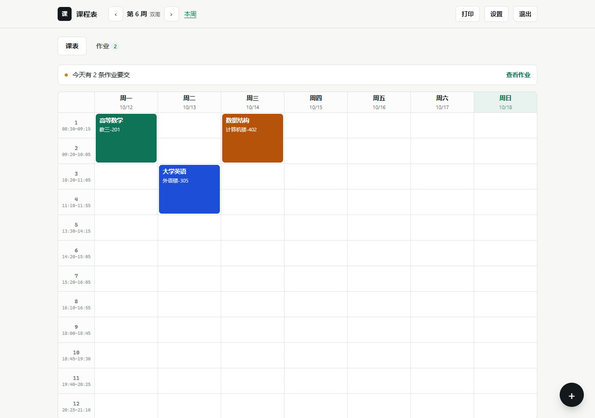

# 课程表与作业提醒

一个单用户的全栈小应用：登录后查看按周排列的课表，记录每门课的作业和截止日期。



## 功能

- 周视图课表：7 天 × 12 节，点空格添加，点课程编辑或删除
- 周次管理：课程支持「每周 / 单周 / 双周」和起止周，填一次覆盖所有对应周
- 节次时间：12 节的开始/结束时间可自定义，课表和添加课程时同步显示
- 时间冲突检测：保存时检查星期、节次、周次是否重叠，可取消或强制保存
- 作业清单：关联课程、截止日期、备注、完成状态，逾期标红
- 今日待办条：首页直接显示今天/明天/逾期的作业数量
- 打印课表：A4 横向排版，隐藏按钮，保留课程颜色
- 作业筛选与搜索：按关键词、课程、完成状态组合过滤
- 深色模式：跟随系统或手动切换，选择会记住
- 键盘快捷键：`N` 新建、`1`/`2` 切换页签、`←`/`→` 换周、`T` 回本周、`/` 搜索、`D` 换主题、`?` 查看全部
- 浏览器提醒：开启后，作业到期前一天或当天弹通知，每天最多一条
- PWA：可安装到桌面，断网时仍能打开已缓存的页面

课程支持「每周 / 单周 / 双周」：填一条记录，就会自动出现在所有对应的周次里，不需要每周复制一遍；修改时也是改一次、全部同步。

节次时间可以在「设置」里逐节填写，课表左侧会显示每节的开始时间，添加课程时会提示所选节次对应的时段。

「设置」里还有一键清空：删除全部课程和作业，账号和节次时间保留。

## 提醒与离线

- 通知需要 https 或 localhost，并在「设置 → 作业提醒」里授权；页面关闭时不会推送，打开后每 10 分钟检查一次，同一自然日最多提醒一条。
- PWA 的 Service Worker 只缓存静态页面，接口请求不走缓存；断网时可以打开界面，但数据需要联网才能同步。

## 技术栈

| 层 | 选择 | 说明 |
| --- | --- | --- |
| 前端 | 原生 HTML / CSS / JavaScript | 无框架，和作品集保持同一套风格 |
| 后端 | Node.js + Express | REST 接口，JSON 传输 |
| 数据库 | SQLite / PostgreSQL | 设置 `DATABASE_URL` 时使用 PostgreSQL（Neon），否则使用本地 `data/app.db` |
| 鉴权 | scrypt 加盐哈希 + 数据库会话 | 密码不存明文，会话可跨 Vercel 实例使用，Cookie 带 HttpOnly |

## 运行

```powershell
cd D:\self\dev\course-planner
D:\self\dev\node\npm.cmd install
D:\self\dev\node\node.exe server.js
```

打开 http://localhost:3000 ，第一次会要求设置密码。

接口冒烟测试会使用临时 SQLite 数据目录，不会影响本地数据：

```powershell
D:\self\dev\node\npm.cmd test
```

## 部署到 Vercel

1. 在 Vercel 项目中设置环境变量 `DATABASE_URL`，值为 Neon 的 PostgreSQL 连接串。
2. 推送仓库后在 Vercel 导入项目，构建命令留空，Node.js 版本选择 22 或更高。
3. `api/[...path].js` 会承接所有 `/api/*` 请求，`public/` 继续作为静态站点发布。

也可以使用 Vercel CLI：

```powershell
D:\self\dev\node\npx.cmd vercel --prod
```

## 目录

```
server.js       接口与鉴权
db.js           SQLite / PostgreSQL 连接与异步查询
schema.js       两套数据库建表语句与默认节次
api/            Vercel Serverless 入口
scripts/        接口冒烟测试
public/
  index.html    页面骨架
  app.js        界面渲染与交互
  app.css       样式
data/app.db     SQLite 数据文件（已被 .gitignore 忽略）
```

## 数据表

- `users`：账号与密码哈希
- `courses`：课程名、星期、节次、周次范围、单双周（`week_parity`）、地点、颜色
- `assignments`：标题、关联课程、截止日期、完成状态
- `periods`：12 个节次的开始与结束时间
- `settings`：学期起始日期等键值配置
- `sessions`：登录会话（数据库只保存令牌哈希）

## 注意

- 第一次部署后请立刻访问站点设置密码，否则谁能先打开谁就能占用账号。
- 本地模式忘记密码只能删除 `data/app.db` 重新开始（会丢失全部课程和作业）。
- 在线模式的数据在 Neon 中，重置数据库密码不会删除课程和作业。
